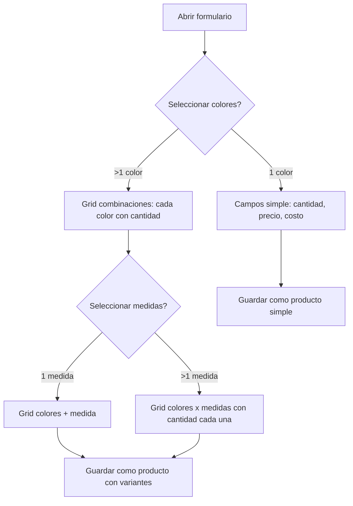

# Plan de Ejecución — Shelf Inventory Redesign

## Fase 0: Housekeeping & Git Hygiene (PREPARACIÓN)

### 0.1 — Actualizar develop con main
- `develop` está 70 commits detrás de main
- Push current develop backup first
- Reset develop = main
- Force push develop (con aprobación del equipo)

### 0.2 — Mergear/Cerrar pr-143
- pr-143 tiene 5 commits no mergeados con código de edge-mesh que ya fue integrado vía PRs #141→#148
- Revisar si hay algo único → si no, eliminar rama local
- Eliminar ramas residuales: `codex/backup-main-*`, `pr-143`

### 0.3 — Mergear/Cerrar PRs dependabot activos
- #150 pnpm/action-setup 3→6 ✅ merge
- #151 upload-pages-artifact 3→5 ✅ merge (non-breaking)
- #152 deploy-pages 4→5 ✅ merge
- #153 checkout 4→7 ✅ merge
- #149 vite bump ✅ merge
- #154 npm-dependencies → revisar si hay breaking changes

### 0.4 — Cerrar issues viejos o reasignarlos
- #87 (Strategic Pivot May 2026) → ¿sigue vigente? Si no → cerrar
- #134 (Sucursales/Bodegas P2P, label jules) → sigue vigente
- #135 (Historial nodos P2P) → sigue vigente
- #136 (Consenso admin P2P) → sigue vigente
- #139 (Fase 2 edge-mesh CRDT, label jules) → sigue vigente

---

## Fase 1: Actualizar GitCore Docs (PARALELO)

### 1.1 — ARCHITECTURE.md
- [ ] Añadir Edge Mesh Runtime stack (Yjs, PeerJS, WebGPU)
- [ ] Añadir paquetes: edge-mesh, edge-mesh-react, gpu-agent
- [ ] Actualizar project structure con packages nuevos
- [ ] Actualizar data flow incluyendo edge-mesh workflow

### 1.2 — features.json
- [ ] Agregar SRC-EDGE-001 (Edge Mesh Runtime) 
- [ ] Agregar SRC-CRDT-001 (si no está)
- [ ] Agregar WebGPU agent feature
- [ ] Marcar features correctas (revisar implementación 100%)
- [ features.json: actualmente 19 features, faltan las de edge-mesh]

### 1.3 — SRC Docs nuevos
- [ ] Crear SRC-EDGE-001.md (Edge Mesh) → ya existe en docs/src/non-functional/
- [ ] Crear SRC-FUN-015.md (Multi-color + Multi-measure product) **NUEVO**
- [ ] Referenciar en features.json

### 1.4 — README.md
- [ ] Actualizar con packages nuevos
- [ ] Incluir edge-mesh usage
- [ ] Sincronizar con estructura real

---

## Fase 2: Implementar Rediseño Formulario Producto (CRÍTICO ⭐)

**Requerimiento del usuario:**
> Hacer un solo formulario simple. Al seleccionar VARIOS colores y VARIAS medidas, que aparezca por cada combinación un campo de cantidad.

### 2.1 — Análisis (SRC-FUN-015)

Vista actual:
- Modo "Artículo simple" (sin variantes): campos sueltos color, medida, cantidad, precio, costo
- Modo "Con variantes": atributos configurables + tabla de variantes

Problema:
- El usuario quiere SELECCIONAR MÚLTIPLES colores y medidas directo en el formulario base
- Sin tener que entrar al modo variantes y agregar "Atributo 1, Atributo 2"
- Que sea más MINIMALISTA y FUNCIONAL

Solución propuesta:
- En modo simple, cuando el usuario selecciona >1 color (click en varios chips de color) → automáticamente se activa un grid de combinaciones con campos de cantidad
- Lo mismo con medidas: seleccionar varias → se expande grid de combinaciones
- El formulario siempre se ve simple hasta que se seleccionan múltiples opciones
- No más toggle "Artículo simple / Con variantes"

**Estados del formulario:**
1. **Una opción** (1 color, 1 medida, o campo libre) → formulario simple actual (cantidad única)
2. **Múltiples opciones** (varios colores, varias medidas) → grid automático de combinaciones con cantidades

### 2.2 — Implementación

**Archivos a modificar:**

| Archivo | Cambio |
|---------|--------|
| `packages/p2p-mesh-core/src/types.ts` | Añadir `colors?: string[]`, `sizes?: string[]` a Product |
| `apps/shelf-inventory/components/Inventory.tsx` | Rediseño completo del ProductForm |
| `apps/shelf-inventory/lib/productVariants.ts` | Adaptar generación de variantes desde arrays seleccionados |
| `apps/shelf-inventory/lib/inventoryConfig.ts` | Añadir default config para multi-color/multi-measure |
| `apps/shelf-inventory/context/AppContext.tsx` | Adaptar reducer para nuevo formato |
| `locales/*.json` | Añadir traducciones para nueva UI |
| `.gitcore/features.json` | Añadir SRC-FUN-015 |
| `docs/src/features/SRC-FUN-015.md` | Crear documento SRC |

### 2.3 — UX Flow Específico

---

## Fase 3: Issues a Jules (PARALELO)

### Issues a crear para Jules:

**Issue 1:** `[feat] Rediseñar ProductForm para multi-color y multi-measure nativo`
- Archivos: Inventory.tsx, productVariants.ts, inventoryConfig.ts
- Label: `jules`
- Prioridad: P0
- Body: Descripción completa del requerimiento + mock de UX

**Issue 2:** `[chore] Actualizar GitCore docs: ARCHITECTURE.md, features.json, README.md`
- Archivos: .gitcore/ARCHITECTURE.md, .gitcore/features.json, .gitcore/planning/TASK.md, README.md
- Label: `jules`
- Prioridad: P1

**Issue 3:** `[chore] Housekeeping: actualizar develop, mergear dependabot PRs, limpiar ramas`
- Label: `jules`
- Prioridad: P0
- Nota: Este lo hago YO directamente con exec, no va a Jules (operaciones git)

**Issue 4 (si aplica):** `[feat] Cerrar Issue #87 - Strategic Pivot`
- Revisar si el pivot offline-first + local AI está completo
- Cerrar o actualizar según estado

---

## Fase 4: Testing & QA

- [ ] Cypress E2E tests para nuevo formulario
- [ ] Tests de validación (precios, cantidades, SKU duplicados)
- [ ] Test de renderizado variantes desde arrays de colores/medidas
- [ ] Test de migración datos existentes (productos viejos sin romperse)
- [ ] Test P2P sync con nuevo formato de producto

---

## Timeline Estimado

| Fase | Duración | Dependencias |
|------|----------|-------------|
| Fase 0 — Git Hygiene | 30 min | Ninguna |
| Fase 1 — GitCore Docs | 1 hora | Fase 0 (repo limpio) |
| Fase 2 — Implementación | 3-4 horas | Fase 0 |
| Fase 3 — Issues Jules | 15 min | Fase 0, +Fase 2 specs |
| Fase 4 — Testing | 2 horas | Fase 2 |
| **Total** | **~7 horas** | |

---

## Nota de Producción

⚠️ **Hay usuarios activos.** Estrategia:
1. Main se congela durante implementación (0 deploys rotos)
2. Develop es la rama de trabajo
3. PR → revisión → merge a main con CI verde
4. Deploy a Vercel desde main después de merge exitoso
5. Si hay bug crítico → revert último commit en main

---

Generated: 2026-06-27
