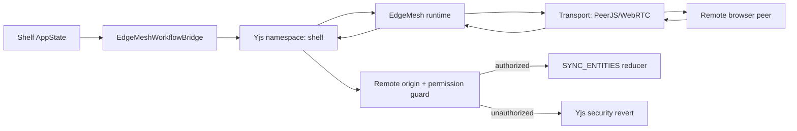

# SRC-EDGE-001: Edge Mesh Runtime

- **ID:** SRC-EDGE-001
- **Name:** Edge Mesh Runtime
- **Priority:** P0 (Core)
- **Status:** ⚠️ Partial
- **Implementation:** 78%
- **Category:** EDGE (Local-first edge mesh)
- **SDLC:** Hardening
- **SSOT:** `.gitcore/features.json` and `.gitcore/features-details.json`

> **Audit 2026-07-18:** 78% · partial · maturity `integrated`. SSOT: `.gitcore/features.json`.

## Description

Edge Mesh is Shelf's reusable browser-to-browser runtime for local-first collaboration. It builds on P2P transport, Yjs CRDT updates, peer-aware remote origins, and application-level authorization so Shelf can synchronize data between browsers without trusting every remote mutation.

The runtime lives primarily in `packages/edge-mesh`, with React bindings in `packages/edge-mesh-react` and the Shelf application bridge in `apps/shelf-inventory/components/EdgeMeshWorkflowBridge.tsx`.

## Primary Actor

Store operator using multiple browsers, devices, or team members in an offline-first workflow.

## Dependencies

- **SRC-P2P-001** (P2P Mesh Network): peer connectivity and PeerJS/WebRTC transport.
- **SRC-CRDT-001** (CRDT Sync): Yjs documents, maps, state vectors, and updates.
- **SRC-PQC-001** (Post-Quantum Cryptography): secure transport and future capability signing.
- **SRC-QA-001** (Testing Infrastructure): Playwright coverage for synchronization and unauthorized mutation blocking.

## User Story

> As a store operator, I want browsers to share inventory state directly while preserving permissions, so local-first collaboration remains fast, secure, and resilient when cloud connectivity is unavailable.

## Acceptance Criteria

1. Exposes a reusable `@shelf/edge-mesh` package with node, transport, storage, protocol, presence, authz, and CRDT namespace primitives.
2. Supports Yjs namespaces that broadcast local deltas and apply remote deltas.
3. Applies incoming remote updates with `{ type: 'remote', peerId }` origin metadata.
4. Prevents re-broadcast loops for updates that were received from remote peers.
5. Integrates with Shelf through a `shelf` namespace that mirrors core application collections.
6. Enforces collection-level permissions before remote Edge Mesh mutations reach app state.
7. Reverts unauthorized remote mutations inside the CRDT document.
8. Exposes localhost-only E2E harnesses for deterministic browser-to-browser tests.
9. Keeps WebGPU agent execution as an extension point for future edge-local AI tasks.

## Open Work

The reusable runtime primitives exist, but app-level adoption is still partial. #139 remains open until Shelf uses the library-first sync layer as the main path, ack/retry is formalized, and multi-node browser convergence is covered without manual test rebroadcast helpers.

## Technical Stack

| Technology | Use |
| --- | --- |
| Yjs | CRDT documents, maps, encoded updates, state vectors |
| PeerJS/WebRTC | Browser-to-browser transport |
| React | `EdgeMeshProvider`, `useEdgeMesh`, `useCollection` |
| p2p-mesh-core | Shelf roles, peers, permissions, and app state contract |
| Playwright | Multi-browser synchronization and security E2E tests |
| WebGPU | Future peer-local agent execution |

## Runtime Architecture

## Shelf Namespace Collections

The Shelf workflow bridge synchronizes these collections through Yjs maps:

| Collection | Remote mutation rule |
| --- | --- |
| `products` | Requires `canEditProducts` |
| `sales` | Requires `canEditSales` |
| `clients` | Requires `canEditClients` |
| `suppliers` | Requires `canEditSuppliers` |
| `purchaseOrders` | Requires `canEditPurchaseOrders` |
| `arqueoSessions` | Requires `canViewArqueo` |
| `ocrResults` | Requires `canEditPurchaseOrders` |
| `teamMembers` | Master peer only |
| `auditLogs` | Allowed unless action contains `PRIVILEGE` |

Unknown peers cannot mutate restricted collections. The master peer is resolved from the current app state and can apply all remote changes.

## Sync Flow

1. Shelf app state changes are copied into Yjs maps with local origin `shelf-edge-workflow`.
2. `EdgeMesh` listens for local Yjs updates and broadcasts encoded namespace updates over the configured transport.
3. A receiving peer decodes the namespace and applies the update with origin `{ type: 'remote', peerId }`.
4. The workflow bridge observes the Yjs map event.
5. Local workflow origins and security revert origins are ignored.
6. Remote origins are authorized against current app state permissions.
7. Authorized changes are batched and dispatched as `SYNC_ENTITIES`.
8. Unauthorized changes are reverted in the Yjs document with origin `shelf-edge-security-revert`.

## Security Notes

- Remote origin metadata is mandatory for permission checks.
- The bridge does not trust the incoming payload alone; it uses the sending peer id from transport-origin metadata.
- Unauthorized insertions, updates, and deletions are reverted before they become app state.
- Privilege-changing audit entries are rejected when received from non-master peers.
- The local E2E harness is only exposed on `localhost`, `127.0.0.1`, or `::1`.

## Tests

| Test file | Coverage |
| --- | --- |
| `packages/edge-mesh/tests/*.test.ts` | Core package behavior and Yjs synchronization |
| `apps/shelf-inventory/tests/edge-mesh-sync.spec.ts` | Cross-browser CRDT update import/export and remote mutation rejection |
| `apps/shelf-inventory/tests/security-sync.spec.ts` | Local unauthorized mutation blocking |
| `apps/shelf-inventory/tests/p2p-sync.spec.ts` | P2P sync compatibility with the existing workflow |

## Implementation References

- `packages/edge-mesh/src/edge-mesh.ts`
- `packages/edge-mesh/src/types/index.ts`
- `packages/edge-mesh-react/src/index.tsx`
- `apps/shelf-inventory/lib/edge-mesh-workflow.ts`
- `apps/shelf-inventory/components/EdgeMeshWorkflowBridge.tsx`
- `apps/shelf-inventory/tests/edge-mesh-sync.spec.ts`
