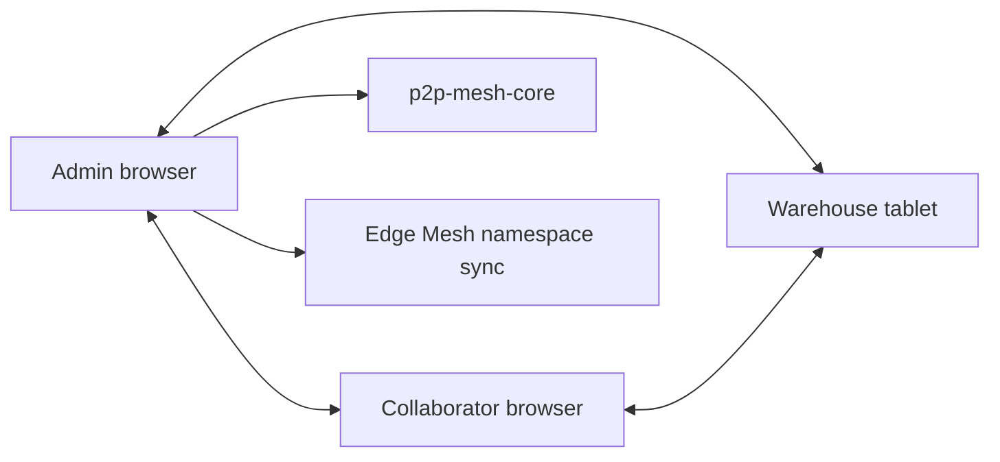

# SRC-P2P-001: P2P Mesh Network

- **ID:** SRC-P2P-001
- **Name:** P2P Mesh Network
- **Priority:** P0 (Core)
- **Status:** ⚠️ Partial
- **Implementation:** 90%
- **Category:** P2P (P2P Mesh Sync)
- **SDLC:** Hardening
- **SSOT:** `.gitcore/features.json` and `.gitcore/features-details.json`

> **Audit 2026-07-18:** 90% · implemented · maturity `hardened`. SSOT: `.gitcore/features.json`.

## Description

Shelf uses browser-to-browser P2P networking to synchronize offline-first data without a central application server in the hot path. The existing `p2p-mesh-core` workflow continues to provide roles, permissions, audit semantics, and app-level sync. `@shelf/edge-mesh` now layers a reusable CRDT namespace runtime on top of P2P transport for the next generation of browser collaboration.

## Primary Actor

Store operator or team member using Shelf from multiple devices.

## Dependencies

- **SRC-PQC-001** (Post-Quantum Cryptography): secure handshake and encrypted transport.
- **SRC-CRDT-001** (CRDT Sync): conflict-free state convergence.
- **SRC-EDGE-001** (Edge Mesh Runtime): transport-agnostic namespace replication.

## User Story

> Como usuario, quiero que mis dispositivos se conecten directamente para compartir datos aunque el servicio central no este disponible.

## Acceptance Criteria

1. Peer discovery and direct connections through PeerJS/WebRTC.
2. Decentralized mesh topology with reconnect behavior.
3. Master/admin peer semantics for permission-sensitive workflows.
4. Local development and E2E use the local PeerServer on localhost.
5. Edge Mesh can broadcast encoded namespace updates to connected peers.
6. Existing P2P app sync remains compatible while Edge Mesh is adopted incrementally.

## Open Work

This SRC is not fully closed while issues #134, #135, and #136 remain open. Shelf still needs branch/warehouse context isolation, persistent node history, failover integration, admin consensus UI, and advanced multi-node validation.

## Technical Stack

| Technology | Use |
| --- | --- |
| PeerJS | Browser peer identity and WebRTC connection management |
| WebRTC | Low-latency P2P data channels |
| `p2p-mesh-core` | Existing app sync, permissions, roles, audit state |
| `@shelf/edge-mesh` | Reusable namespace-level CRDT update transport |

## Architecture



## Technical Details

- **Peer ID:** generated by PeerJS and exposed to tests through the app harness.
- **Dev transport:** localhost, `127.0.0.1`, and `::1` select local PeerJS options for deterministic E2E runs.
- **Authority:** master peer can apply protected Edge Mesh mutations; collaborators require collection-specific permissions.
- **Compatibility:** `p2p-sync.spec.ts` continues to validate the original two-browser product sync path.

## Related Commits

```text
feat(p2p): implement SRC-P2P-001 - p2p mesh network
feat: wire edge mesh into shelf workflow
test: add edge mesh e2e sync and security coverage
```
